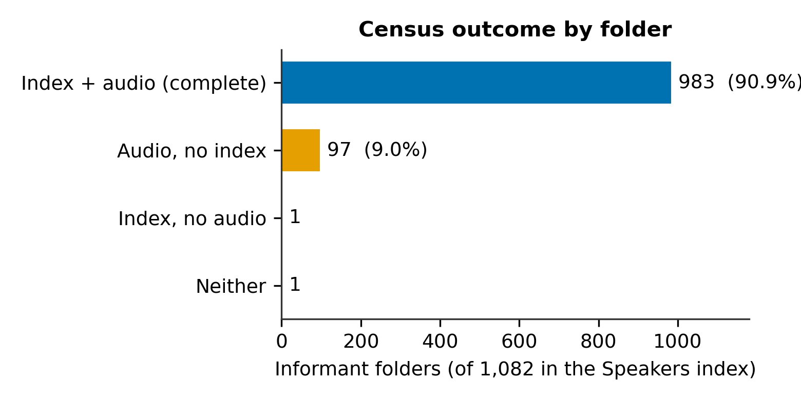
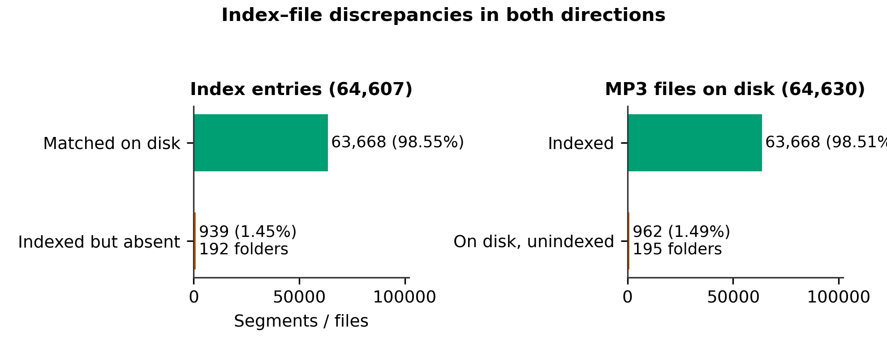
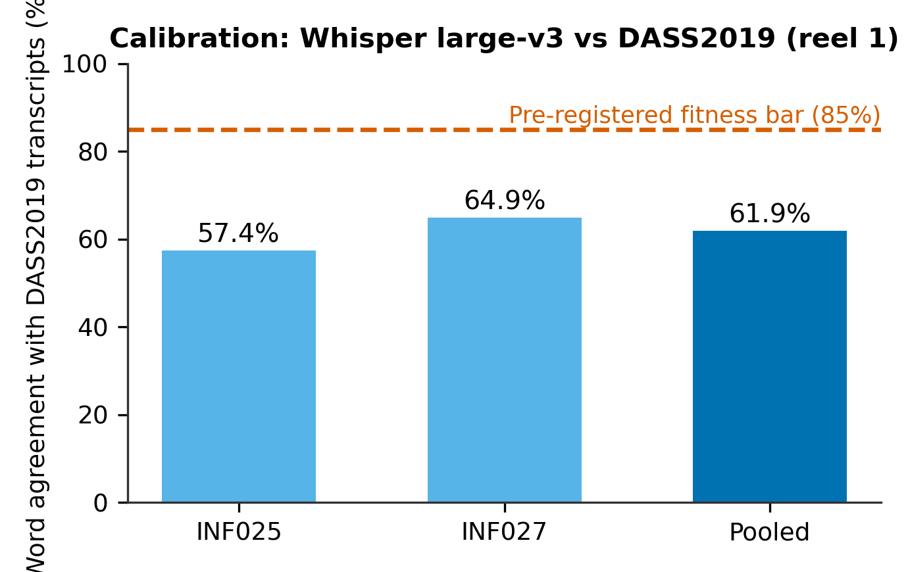

# The Transcripts Were Never There: A Full-Pile Audit of the Linguistic Atlas of the Gulf States Web Archive, and a Failed Calibration for ASR Re-Transcription

Author: Atharva Chourey
Affiliation: Atharva Chourey Lab (independent research lab)
ORCID: 0009-0009-9423-1718 (https://orcid.org/0009-0009-9423-1718)

*Manuscript — not yet peer-reviewed. Human–AI collaboration: the audit was designed, pre-registered and executed jointly by the lab's researcher and an AI research partner (Muse), with all scripts, intermediate data and per-segment records preserved in the project repository for inspection.*

---

## Abstract

The Linguistic Atlas of the Gulf States (LAGS; interviews 1968–83) survives
online as 1,082 informant folders of audio at the Linguistic Atlas
Project; its formal products — most recently DASS2019
— have used only 64 speakers. We pre-registered a transcription-fidelity
audit of the pile: re-transcribe every informant's audio with a
general automatic speech recognition (ASR) ruler and score agreement with
the original transcriptions. The audit's first finding is that the
comparison cannot be run: the folders contain no transcriptions. The
per-informant `.xml` is an audio segment index, not a transcript; each
folder's only text is a biography; verbatim transcripts exist only for
DASS2019's 64, in a separate tree. We therefore report (i) a census and
index-integrity audit, and (ii) the pre-registered calibration gate on
the curated anchor. The census finds 983 of 1,082 folders
(90.9%) hold audio and index, totalling 70,542 segment MP3s across
5,807 reels; but the index disagrees with the files in both directions
— 939 indexed segments (1.45%) absent on disk and 962 files unindexed
(1,901 in all), including a column-scrambled index and a
folder whose 81 indexed segments have no audio. The calibration gate
**fails**: re-transcribing two DASS2019
speakers' pile MP3 segments (reel 1; 18,425 reference words) with Whisper large-v3 yields word
agreement of 57.4% and 64.9% (pooled 61.9%), far below the pre-registered
85% fitness bar. Per the pre-registration, no fidelity claim is made for
the ~850 never-audited informants: the stranded majority of a foundational
dialect survey is auditable only for completeness and index integrity.

## 1. Introduction

LAGS (Pederson, McDaniel & Adams 1986–1992) interviewed 914 informants across the Gulf States between 1968 and
1983; its web presentation at the Linguistic Atlas Project (LAP; Linguistic Atlas Project 2026) exposes
1,082 informant folders (including variant and supplement folders) of
topic-segmented MP3 audio. Scholarly reuse has concentrated on a curated
minority: DASS2019, the LAP's own digital corpus (Kretzschmar et al. 2019), covers 64 speakers, 344
hours, 409 reels. The remaining ~850 informants' recordings — the large
majority of the survey — have never, to our knowledge, been audited against
anything: not for completeness, not for index accuracy, and not for
transcription fidelity, the last because no transcriptions were ever
published for them.

That gap suggested a now-standard audit design. Modern ASR offers a cheap
second ruler: re-transcribe surviving audio with a general model and score
agreement against the original transcripts; where agreement is high on a
calibration subset with known transcripts, the ruler can be extended,
cautiously, to the untranscribed remainder. We pre-registered exactly that
design, with four predictions (completeness ≥90%; calibration agreement
≥85% on DASS2019-overlap informants; a ≥3-point fidelity gap outside the
curated sample; disagreement concentrated by questionnaire topic), before
running any comparison.

The design broke on contact with the files, in an instructive way. This
paper reports what the pile actually supports: a census, an index-integrity
audit, a calibration verdict, and a bounded qualitative check — and it
reports the pre-registered comparison's impossibility as a result in its
own right, since any future user of this archive will otherwise repeat our
initial misreading of what its `.xml` files are.

## 2. What the folders contain

Each informant folder holds an `Audio/` tree (per-reel directories of
topic-segment MP3s, ~270 s each, cut by questionnaire region from the
digitised reels), a `Text/` directory containing only the informant's
biography, and a segment index as `.xml` (984 folders), `.xlsx` (970) or
`.xls` (22). The index's `<entry>` elements carry the segment's id, reel,
topic label, file name and path, and informant demographics. They carry no
transcribed text. We verified this on the Campaign-10 sample folder and by
opening the only three folders in the pile whose `Text/` holds a
non-biography-named text file (INF134C, INF187, INF413): all three are
biography-format texts. The phonetic field worksheets from which the atlas
was compiled are not present in any folder, in any format.

The sole verbatim transcripts on the site are DASS2019's (Kretzschmar et al. 2019; the parent DASS corpus is distributed by the Linguistic Data Consortium as LDC2012S03, and in NLP form as LDC2016S05): per-reel
orthographic transcripts with speaker labels and annotation codes, for 64
speakers, in a separate project tree. Five of the 64 are replacements for
original DASS speakers withdrawn for poor audio.

## 3. Methods

**Census.** We crawled the Speakers index and every folder's listings, and
for each folder holding an index, compared every indexed MP3 file name
against the files present, in both directions. A first pass corrupted by
proxy throttling (329 folders with transient errors) was repaired by two
re-crawls; the final pass leaves one unresolvable entry, an index
placeholder folder literally named `Not Ready`. Variant folders (suffixed
informant numbers, plus two urban-supplement folders) are counted as their
own line throughout, never merged into their base informants.

**Calibration.** For DASS2019-overlap informants we re-transcribed the LAGS
folders' own reel-1 MP3 segments with Whisper large-v3 (Radford et al. 2023; faster-whisper, SYSTRAN 2023;
CTranslate2 int8, Klein et al. 2020; CPU; language forced to English; beam 5; VAD on, Silero Team 2021) — a
general ruler, never any DASS-fine-tuned variant (Coats 2026) — and scored agreement
against the DASS2019 reel-1 transcript, cleaned of annotation codes (inner
words of descriptive codes retained), overlap markers and speaker labels.
Agreement is 1 − WER over normalised tokens (lowercase, punctuation
stripped), aligned with jiwer (8x8, Inc. 2025); per-segment disagreement is attributed by
alignment position and checks exactly against the S+D+I totals. The
registered six-informant frame was rescoped by dated amendments, written
before the runs they govern, to two informants (025, 027) on measured
compute grounds (0.29–0.80× realtime on the available throttled CPU); the
rescope cannot affect the verdict, since the 85% bar was already
arithmetically unreachable after the first informant scored 57.4% on 7,515
reference words. One segment (INF027, reel 1, segment 14) enters a
deterministic repetition loop under the registered configuration and was
scored conservatively — zero hypothesis tokens, its reference words counted
as deletions — and is flagged wherever the informant appears.

**Spot-check.** Reel 1 segment 1 of four non-curated informants (INF001–
INF004) was transcribed with the same ruler and read qualitatively for
intelligibility and topic match. It is not a fidelity measure and is never
reported as one.

Downloads were staged one informant at a time and deleted after
transcription; no bulk mirror was made (≈31 segments, ≈2.3 hours of audio,
of ~5,800 reels).

## 4. Results

### 4.1 Completeness (P1: pass)

983 of 1,082 informant folders (90.85%) hold both an index and at least one
MP3, meeting the pre-registered 90% bar. 1,080 folders hold audio (70,542
MP3s, 5,807 reels); 97 hold audio but no index; one (INF304) holds an index
but no audio; one (INF206A) holds neither. Of the 64 DASS2019 speakers, all
64 have LAGS folders and 62 are in the denominator (INF040 and INF079 are
not).

**Figure 1.** Census outcome for the 1,082 informant folders in the LAGS Speakers index. 983 folders (90.9%) hold both a segment index and at least one MP3, meeting the pre-registered 90% completeness bar (P1); 97 hold audio but no index; INF304 holds an index but no audio; INF206A holds neither. The pile totals 70,542 segment MP3s across 5,807 reels.

### 4.2 Index integrity

Of 64,607 indexed MP3 entries, 939 (1.45%) name files absent on disk, spread
over 192 folders; 962 files present on disk appear in no index, spread over
195 folders. Three verified corruption classes account for the extreme
cases: path-valued file names pointing at a misnamed tree (INF209A; its
index matches nothing), an index whose audio is entirely absent (INF304;
81 entries), and column-scrambled index rows (INF436; all 104 of its files
unindexed despite a full index file).

**Figure 2.** Index–file discrepancies in both directions. Left: of 64,607 indexed MP3 entries, 939 (1.45%, across 192 folders) name files absent on disk. Right: of 64,630 MP3 files present in denominator folders, 962 (1.49%, across 195 folders) appear in no index. Total mismatches: 1,901.

### 4.3 Calibration (P2: fail)

| Informant | Segments | Ref words | WER | Agreement |
|---|---|---|---|---|
| LAGS(INF025) | 11/11 | 7,515 | 0.426 | 57.4% |
| LAGS(INF027) | 13/14 * | 10,910 | 0.351 | 64.9% |
| Pooled | 24/25 | 18,425 | 0.381 | **61.9%** |

* Segment 14 decode-failed; scored as deletions (a floor for this informant).

**Figure 3.** Calibration on the curated anchor (P2: fail). Word agreement of Whisper large-v3 with the DASS2019 reel-1 transcripts: INF025 57.4% (7,515 reference words), INF027 64.9% (10,910 reference words; segment 14 decode-failed and scored as deletions, so this is a floor), pooled 61.9% (18,425 reference words) — 23.1 points below the pre-registered 85% fitness bar.

Hypothesis/reference token ratios (1.02, 0.85) show the ruler hears
essentially all the speech; the gap is word-level: genuine recognition
errors on dialect speech and 1970s field recordings, compounded by
convention mismatches against verbatim transcripts that preserve false
starts and dialect spellings and write numbers as words (digit-format
mismatches are only ~5% of substitution chunks in INF025). One further
component is the pile's own segmentation: at least one 272 s segment file
(INF025 reel 1 segment 03) contains only ~40 s of speech — verified by a
no-VAD re-decode yielding the same 55 tokens — so reference speech for that
span is scored as deleted. The calibration therefore measures the ruler
*through the MP3 layer a real user would actually download*, which we take
to be the operationally relevant quantity, and a pessimistic bound on the
ruler against the WAV masters.

Under the pre-registration, agreement below 85% declares the ruler unfit
and forbids any pile-wide fidelity claim. We comply: **no fidelity estimate
is offered for any non-curated informant.**

### 4.4 Concentration (P4)

Across the 24 scored segments, the five highest-disagreement segments hold
43.5% of all disagreement tokens; by topic, Public Institutions (22.8%),
Family (18.1%) and Dwellings (17.9%) lead. The two largest single segments,
however, are boundary artefacts — the segment following INF025's
near-speechless segment 03, and INF027's segment 13 absorbing its
decode-failed successor — so at this sample size the concentration is as
much a property of the pile's segmentation failures as of questionnaire
topics.

### 4.5 The untranscribed remainder (P3: void)

Outside the curated 64, verbatim-transcript coverage is 0 of 1,018 folders,
so the registered fidelity-gap prediction has no measurable referent and is
reported void, not failed. The four spot-checked non-curated segments are
all intelligible, coherent interview speech matching their topic labels
(a "blind tiger" narrative under Wild Animals; creek-and-county elicitation
under Topography; a timber reminiscence under Trees and Shrubs; name
elicitation under Names, Titles and Occupations).

## 5. Discussion

Three conclusions survive the audit. First, the LAGS web pile is a
*well-preserved audio archive with a decaying index*: nine-tenths complete
after four decades and at least one platform migration, yet carrying ~1,900
index/file mismatches, in a long tail plus a few folders of outright index
corruption that no user could detect without a pile-wide pass of exactly
this kind. Second, the pile's scholarly bottleneck is not audio quality —
the spot-checks are plainly intelligible — but the absence of the field
transcriptions, whose non-publication converts a fidelity question that
could have been answered into one that cannot. Third, the calibration
result disciplines a tempting shortcut: on genuinely verbatim references
for dialect field recordings, a strong general ASR ruler in 2026 still sits
near 60% word agreement, and any pipeline that would silently extend such
a ruler to untranscribed legacy audio — for search, for dialectometry, for
training data — inherits that error rate invisibly. The pre-registered
85% gate, which the ruler failed by 23 points, is the kind of check that
has to be run *before* the extension, on the archive's own curated anchor,
or not at all.

## 6. Limitations

Calibration rests on two informants and one reel each (dated amendments;
the verdict is insensitive to the rescope, as §3 shows). References are
verbatim where the ruler is normalising, so agreement understates
intelligibility; we quantify only the number-format component (~5% of
substitutions). Segmentation artefacts load onto the calibration in the
pessimistic direction. Census figures are as of 18 November 2026 against a
live site. The decode-failed segment is scored, not recovered; a different
decoder configuration might recover it at the cost of changing the ruler
mid-study.

## 7. Data and code availability

All scripts (`census.py`, `census_fix.py`, `asr_audit.py`,
`complete_027.py`, `analysis.py`), the pre-registration and its five
amendments, the full census table (`data/census.csv`), the analysis tables
(`data/analysis_tables.json`), and every per-segment ASR record
(`results/asr/`) are preserved in the project repository. This manuscript is
public and not yet peer-reviewed; it has not been submitted to any venue.

## References

8x8, Inc. 2025. *jiwer: Similarity measures for automatic speech recognition
evaluation* [software]. https://pypi.org/project/jiwer/

Coats, Steven. 2026. A fine-tuned ASR model for historical American dialect
recordings. In *Proceedings of the Fifteenth Language Resources and
Evaluation Conference (LREC 2026)*, 1372–1381. European Language Resources
Association (ELRA).

Klein, Guillaume, Dakun Zhang, Clement Chouteau, Josep Crego & Jean
Senellart. 2020. Efficient and high-quality neural machine translation with
OpenNMT. In *Proceedings of the 4th Workshop on Neural Generation and
Translation (WNGT 2020)*, 211–217. Association for Computational
Linguistics. (Describes CTranslate2, the inference engine used here.)

Kretzschmar, William A., Jr., Margaret E. L. Renwick, Lisa M. Lipani,
Michael L. Olsen, Rachel M. Olsen, Yuanming Shi & Joseph A. Stanley. 2019.
Transcriptions of the Digital Archive of Southern Speech. Linguistic Atlas
Project, University of Georgia. http://www.lap.uga.edu/Projects/DASS2019/

Linguistic Atlas Project. 2026. LAGS web archive: Speakers index and
informant folders. University of Georgia.
https://www.lap.uga.edu/Projects/LAGS/Speakers/ (census as of 18 November
2026).

Linguistic Data Consortium. 2016. *Digital Archive of Southern Speech —
NLP Version*. Philadelphia: Linguistic Data Consortium. LDC2016S05.

Olsen, Rachel M., Michael L. Olsen, Joseph A. Stanley, Margaret E. L.
Renwick & William A. Kretzschmar, Jr. 2017. Methods for transcription and
forced alignment of a legacy speech corpus. *Proceedings of Meetings on
Acoustics* 30: 060001. doi:10.1121/2.0000559

Pederson, Lee, Susan Leas McDaniel & Carol M. Adams (eds.). 1986–1992.
*Linguistic Atlas of the Gulf States*. 7 vols. Athens, GA: University of
Georgia Press.

Radford, Alec, Jong Wook Kim, Tao Xu, Greg Brockman, Christine McLeavey &
Ilya Sutskever. 2023. Robust speech recognition via large-scale weak
supervision. In *Proceedings of the 40th International Conference on
Machine Learning*, PMLR 202: 28492–28518.

Silero Team. 2021. *Silero VAD: Pre-trained enterprise-grade voice activity
detector* [software]. https://github.com/snakers4/silero-vad (the VAD model
used by faster-whisper).

SYSTRAN. 2023. *faster-whisper: Faster Whisper transcription with
CTranslate2* [software]. https://github.com/SYSTRAN/faster-whisper

University of Georgia. 2012. *Digital Archive of Southern Speech*.
Philadelphia: Linguistic Data Consortium. LDC2012S03.

---

*Run record: pre-registration and novelty scrub, 2026-11-18; census,
calibration and spot-checks, 2026-11-18 – 2026-11-19. RESULTS-EXHAUSTED.md
in the project repository carries the full scorecard, per-segment tables
and methods detail.*
